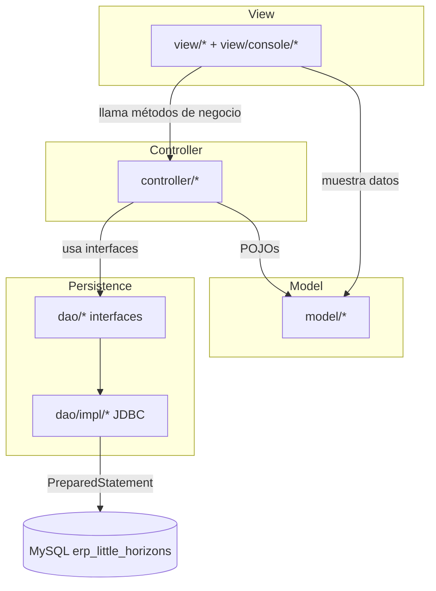

# 1. Título

**Little Horizons ERP** — Sistema de Gestión Educativa de Consola  
Colegio Internacional Little Horizons S.A.S.

---

# 2. Descripción

## Propósito

Aplicación de consola en Java que centraliza los procesos académicos, extracurriculares, financieros y de recursos del colegio (preescolar a 11°, más de 500 estudiantes y cerca de 40 profesores). Sustituye hojas de cálculo y archivos dispersos por una base de datos MySQL y una interfaz de menús con validación robusta.

## Problemas que resuelve

- Matrícula y seguimiento académico por grado y período sin duplicar datos.
- Cálculo de promedios, detección de inasistencias preocupantes y listado de morosos.
- Control de cupos en clubes, préstamos de recursos y conflictos de horario de profesores.
- Registro de pagos con descuentos (hermanos, becas) y generación de factura electrónica en archivo TXT legible (CUFE, QR textual, resolución simulada DIAN).
- Auditoría básica mediante log de errores en disco.

## Funcionalidades principales

| Módulo | Capacidades |
|--------|-------------|
| Estudiantes y acudientes | CRUD, contactos de emergencia, vínculo N:M, matrícula por año/grado |
| Académico | Materias, inscripciones, notas 0.0–5.0, promedios (Streams), asistencia |
| Profesores | Directorio, asignación a materias, horarios con validación de conflictos |
| Extracurricular | Clubes (cupo), membresías, eventos y posiciones en competencias |
| Financiero | Conceptos, pagos, descuentos Strategy, morosos, factura TXT |
| Recursos | Catálogo, préstamos a estudiante/profesor, reporte de vencidos |
| Reportes | Rendimiento, inasistencias, participación, morosos, préstamos vencidos |

---

# 3. Autores

| Rol | Nombre | Correo |
|-----|--------|--------|
| Desarrollador | *[Completar con tu nombre]* | *[tu correo]* |
| Tutor / Trainer | *[Nombre del trainer]* | — |

Proyecto académico de ingeniería de software. Los datos de la institución y de la DIAN en las facturas son **simulados**.

---

# 4. Tecnologías

| Componente | Tecnología / versión |
|------------|----------------------|
| Lenguaje | Java 17+ |
| Build | Maven 3.8+ |
| Base de datos | MySQL 8.0+ |
| Driver JDBC | mysql-connector-j 8.4.0 |
| PDF | Apache PDFBox 2.0.31 (opcional; factura por defecto en TXT) |
| Código QR | ZXing (core) 3.5.3 (opcional) |
| IDE recomendado | IntelliJ IDEA (Community o Ultimate) |
| Arquitectura | MVC estricto (consola), sin Spring |

Dependencias declaradas en `pom.xml`. No se usan frameworks de inyección ni ORMs: solo JDBC, `PreparedStatement` y try-with-resources.

---

# 5. Requerimientos previos

1. **JDK 17** o superior (`java -version`).
2. **Maven 3.8+** (`mvn -version`), o el wrapper del IDE.
3. **MySQL 8.0 o superior** en ejecución, con un usuario que pueda crear bases de datos.
4. (Opcional) Cliente MySQL Workbench o CLI para inspeccionar datos.

---

# 6. Configuración de la base de datos

## 6.1 Creación del esquema y datos de prueba

El script oficial de la entrega está en:

```text
docs/database.sql
```

Contiene:

- **Sección 1 – DDL:** tablas del enunciado + tabla justificada `horarios_asignacion`.
- **Sección 2 – DML:** ≥30 registros en estudiantes, acudientes, profesores, materias, registros_academicos, pagos, clubes y recursos.

Ejecución:

```bash
mysql -u root -p < docs/database.sql
```

Esto hace `DROP DATABASE IF EXISTS erp_little_horizons`, crea la BD, las tablas y la carga de datos.

El único cambio respecto al script DDL original del colegio es `horarios_asignacion` (días y horas por asignación de profesor), documentado en `docs/schema-changes.sql`.

## 6.2 Credenciales

1. Copia el ejemplo:

```bash
cp config.properties.example config.properties
```

2. Edita `config.properties` (está en `.gitignore`; **no se sube al repositorio**):

```properties
db.url=jdbc:mysql://localhost:3306/erp_little_horizons?useSSL=false&allowPublicKeyRetrieval=true&characterEncoding=UTF-8&serverTimezone=America/Bogota
db.user=tu_usuario
db.password=tu_contraseña

school.name=Colegio Internacional Little Horizons S.A.S.
school.nit=900123456-7
school.address=Calle 45 # 27-30, Bucaramanga, Santander
school.phone=+57 607 123 4567
school.email=facturacion@littlehorizons.edu.co
school.dian.resolution=Resolucion DIAN No. 18760000001 del 2026-01-15 (simulada)

tax.vat.education=0.00
tax.vat.other=0.19
invoices.dir=invoices
```

## 6.3 Driver JDBC

Maven descarga `mysql-connector-j` automáticamente. Sin Maven, añade el JAR de MySQL Connector/J 8.x al classpath del proyecto.

La conexión se obtiene con el **Singleton** `DatabaseConnection` (`com.littlehorizons.erp.config.DatabaseConnection`), que lee `config.properties` vía `ConfigLoader`.

---

# 7. Instalación y ejecución

## 7.1 Clonar el repositorio

```bash
git clone <URL-del-repo-privado>
cd erp-little-horizons   # o el nombre de la carpeta raíz del proyecto
```

## 7.2 Abrir en el IDE

- IntelliJ: *File → Open* y seleccionar la carpeta que contiene el `pom.xml`.
- Esperar a que Maven importe las dependencias (o *Maven → Reload project*).

## 7.3 Compilar

```bash
mvn clean compile
```

Debe terminar en `BUILD SUCCESS`.

## 7.4 Ejecutar

```bash
mvn exec:java
```

O desde el IDE: ejecutar la clase `com.littlehorizons.erp.Main`.

Antes de arrancar:

1. MySQL debe estar activo.
2. `docs/database.sql` debe haberse ejecutado al menos una vez.
3. `config.properties` debe existir y tener credenciales válidas.

Si la conexión falla, la consola muestra un mensaje claro y el detalle queda en `logs/error_log.txt`.

---

# 8. Estructura del proyecto (MVC y paquetes)

```text
erp-little-horizons/
├── pom.xml
├── config.properties.example
├── .gitignore
├── README.md
├── docs/
│   ├── database.sql              # DDL + DML (Fase 6)
│   ├── schema-changes.sql        # Justificación de horarios_asignacion
│   ├── guia-sustentacion-fase*.md
│   ├── examples/            # ejemplos opcionales
│   └── images/factura-ejemplo.png
├── invoices/                     # facturas TXT generadas en runtime (gitignore)
├── logs/                         # error_log.txt (gitignore)
└── src/main/java/com/littlehorizons/erp/
    ├── Main.java                 # Punto de entrada
    ├── config/                   # AppContext, DatabaseConnection
    ├── model/                    # POJOs y enums
    ├── dao/                      # Interfaces DAO
    ├── dao/impl/                 # Implementaciones JDBC
    ├── controller/               # Lógica de negocio (sin SQL ni System.out)
    ├── view/                     # Menús y pantallas de consola
    ├── view/console/             # Menu, TableRenderer, ConsoleInput, etc.
    ├── service/                  # Factura TXT, SchoolInfo (PDFBox opcional)
    ├── strategy/                 # Descuentos (Strategy)
    ├── dto/                      # Objetos de transferencia si aplica
    ├── exception/                # Jerarquía ErpException
    └── util/                     # Logger, Validator, ConfigLoader, Averages…
```

### Capas (MVC)



- **Vista:** solo entrada/salida y validación de formato; no SQL ni reglas de negocio.
- **Controlador:** reglas (cupos, promedios, morosos, transacciones); no imprime ni abre conexiones directas fuera de los DAO.
- **DAO:** único lugar con SQL; 100 % `PreparedStatement` y try-with-resources.
- **Modelo:** POJOs sin lógica.

`AppContext` es el composition root: construye DAOs e inyecta controladores por constructor.

---

# 9. Principios y patrones

## 9.1 SOLID (ejemplos visibles en el código)

| Principio | Dónde se aplica | Justificación breve |
|-----------|-----------------|---------------------|
| **S** – Single Responsibility | `StudentController` vs `PaymentController` vs `LoanController` | Cada controlador tiene un dominio; los reportes van en controladores aparte (`PerformanceReportController`, etc.). |
| **O** – Open/Closed | `AbstractLoanDaoJdbc`, `DiscountStrategy` | Nuevo tipo de prestatario o de descuento = nueva subclase/estrategia; el código que las usa no cambia. |
| **L** – Liskov | Implementaciones de `LoanDao`, `DiscountStrategy` | Cualquier implementación puede sustituirse sin romper al cliente. |
| **I** – Interface Segregation | `ReadableDao` | Catálogos de solo lectura no se ven obligados a implementar `save`/`delete`. |
| **D** – Dependency Inversion | Constructores de controladores | Dependen de interfaces DAO (`StudentDao`, `PaymentDao`…), no de `*DaoJdbc`. |

Comentarios del estilo `// SOLID: SRP – reason` aparecen en las clases correspondientes para la sustentación oral.

## 9.2 Patrones de diseño

| Patrón | Clase(s) | Problema que resuelve |
|--------|----------|------------------------|
| **Singleton** | `DatabaseConnection`, `AppLogger` | Una sola conexión configurada y un solo archivo de log por proceso. |
| **DAO** | `*Dao` + `*DaoJdbc` | Separa el acceso a datos del resto de la aplicación. |
| **Factory** | `LoanDaoFactory`, `DiscountStrategyFactory` | El controlador no decide con `if/else` qué tabla de préstamos o qué descuento usar. |
| **Strategy** | `DiscountStrategy` y subclases (`NoDiscount`, `SiblingsDiscount`, `ScholarshipDiscount`, `PercentageDiscount`) | Cálculo de descuentos intercambiable sin modificar `PaymentController`. |

---

# 10. Funcionalidades por módulo

### Menú principal

1. Gestión de Estudiantes  
2. Gestión Académica  
3. Gestión de Profesores  
4. Actividades Extracurriculares  
5. Gestión Financiera  
6. Gestión de Recursos  
7. Reportes y Estadísticas  
8. Salir  

### Módulo 1 – Académico / Estudiantes

- CRUD de estudiantes y acudientes; al menos un acudiente por estudiante; un acudiente puede tener varios hijos (hermanos).
- Matrícula por grado y año; estado de matrícula y de estudiante separados según el DDL.
- Inscripción a materias del grado del estudiante por período (I–IV).
- Notas 0.0–5.0 con un decimal; promedio por materia, general y de curso (Streams).
- Asistencia diaria y reporte de inasistencias preocupantes (>3 ausencias en una ventana corta).

### Módulo 2 – Profesores

- Directorio, especialización, estado.
- Asignación N:M a materias por año/sección.
- Horarios (`horarios_asignacion`) con validación básica de conflictos.

### Módulo 3 – Extracurricular

- Clubes con cupo máximo y profesor supervisor; inscripción validando cupo.
- Eventos por tipo; participantes; posiciones cuando `tiene_competencia = TRUE`.

### Módulo 4 – Financiero

- Conceptos con valor base.
- Descuentos por hermanos y becas (Strategy); monto final en `pagos.monto_pagado`.
- Historial por estudiante/acudiente; reporte de morosos (pensión >1 mes sin pago o nunca pagada).
- Factura TXT al confirmar el pago: razón social, NIT, acudiente, ítems, subtotal, IVA configurable, total, CUFE simulado, QR, resolución DIAN simulada. Archivo `factura_NNNNNN.txt` en la carpeta `invoices/`.

### Módulo 5 – Recursos

- Catálogo por categoría y estado.
- Préstamos en tablas separadas (estudiante / profesor); devolución y estado del recurso; reporte de vencidos.

### Módulo 6 – Reportes

- Rendimiento académico, inasistencias, morosos, participación en clubes/eventos, préstamos vencidos (pipelines de Stream API).

---

# 11. Errores y logs

## Sistema de logs

- Clase: `com.littlehorizons.erp.util.AppLogger` (Singleton).
- Archivo: `logs/error_log.txt` (carpeta creada si no existe).
- Formato: timestamp, nivel (`INFO` / `WARNING` / `ERROR`), clase, mensaje; en `ERROR` se adjunta el stack trace.
- API de escritura: `java.nio.file` + try-with-resources.

## Estrategia de excepciones

Jerarquía bajo `ErpException` (unchecked, para poder usarla en lambdas):

| Clase | Uso típico |
|-------|------------|
| `ValidationException` | Datos de entrada inválidos |
| `BusinessRuleException` | Cupo lleno, conflicto de horario, nota fuera de rango, etc. |
| `NotFoundException` | Entidad inexistente |
| `DatabaseException` | Fallos JDBC encapsulados |
| `ConfigurationException` | `config.properties` ausente o inválido |
| `FileOperationException` | Fallo al escribir factura TXT o log |
| `InputClosedException` | Fin de entrada en consola |

La vista captura `ErpException` y muestra un mensaje claro; el detalle técnico queda en el log. La aplicación no debe caer por entradas inválidas del usuario.

---

# 12. Capturas (opcional)

Ejemplos incluidos en el repositorio:

- `docs/images/factura-ejemplo.png` — vista de la factura generada.
- Tras un pago, abre `invoices/factura_XXXXXX.txt` con cualquier editor de texto.

Tras ejecutar la aplicación puedes añadir capturas del menú principal, listados tabulares y pantallas de pago en esta sección o en `docs/images/`.

---

# 13. Problemas conocidos (opcional)

- La columna `año_academico` conserva la ñ del DDL oficial; en Java se mapea a `academicYear` con backticks y `characterEncoding=UTF-8` en la URL JDBC.
- El estado “Vencido” de préstamos no se actualiza solo: se recalcula al consultar o al devolver (no hay EVENT de MySQL obligatorio).
- IVA: tasas en `config.properties` (`tax.vat.education` = 0 %, `tax.vat.other` = 19 %); la educación formal se trata como excluida salvo conceptos configurados como “otros”.
- Borrado de estudiantes: se recomienda borrado lógico (`estado = 'Retirado'`) porque el DDL tiene `ON DELETE CASCADE` sobre pagos y notas.

---

# 14. Mejoras futuras (opcional)

- Interfaz web o escritorio (JavaFX) reutilizando controladores y DAOs.
- Tabla formal de cuentas por cobrar para morosidad más precisa.
- Notificaciones por correo a acudientes.
- Exportación de reportes a CSV/Excel.
- Roles de usuario y autenticación.

---

# 15. Licencia

Proyecto académico. Uso educativo únicamente.  
Las librerías de terceros conservan sus licencias:

- MySQL Connector/J — GPL / comercial según uso.
- Apache PDFBox — Apache License 2.0.
- ZXing — Apache License 2.0.

Los datos de facturación DIAN y la razón social del colegio en el código de ejemplo son **simulados**.

---

# 16. Contacto

Para dudas sobre la entrega o la sustentación:

- Desarrollador: *[tu correo]*
- Trainer / evaluador: *[correo del trainer]*
- Repositorio: privado en GitHub; el trainer debe estar como colaborador con permiso de lectura.

---

*Última actualización del README: Fase 7 del proyecto Little Horizons ERP.*
