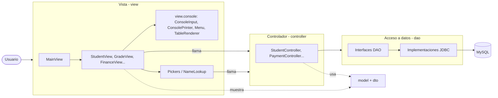

# Guía de sustentación – Fase 4: Vistas de consola, menús y validación

## 0. Cómo ejecutar
1. `config.properties` listo y MySQL activo (`docs/schema-changes.sql` aplicado).
2. `mvn compile exec:java` (o ejecutar `Main` desde el IDE).
3. Windows (cmd/PowerShell): antes de ejecutar, `chcp 65001` para ver las cajas ╔═╗ y las tildes. IntelliJ ya usa UTF-8.

## 1. Diagrama de capas (MVC)

Regla verificada con `grep`: ninguna vista importa `java.sql` ni `dao`; ningún controlador usa `System.out`; el único `System.out` está en `Main` (crea el PrintStream UTF-8) y el único `println` real está en `ConsolePrinter`.

## 2. Qué hace cada clase
**Paquete `view.console` (infraestructura reutilizable)**
| Clase | Qué hace / por qué existe |
|---|---|
| `ConsolePrinter` | Única clase que escribe en pantalla: cajas, mensajes ✔ ✖ ⚠ ℹ, tablas y campos. |
| `ConsoleInput` | Única clase que lee el teclado. Repite la pregunta hasta que el formato es válido (entero en rango, decimal, fecha dd/mm/aaaa estricta, hora, s/n, texto obligatorio). Si el teclado se cierra lanza `InputClosedException`. |
| `TableRenderer` | Convierte encabezados + filas en una tabla alineada con `┌─┬─┐`. Recorta celdas largas (32 car.) y pone `-` en vacíos. |
| `PagedTable` | Muestra listas largas de 15 en 15 (hay 500+ estudiantes). |
| `Menu` | Menú numerado. Cada opción = texto + lambda (`Runnable`). Atrapa **todas** las excepciones: `ErpException` → mensaje; cualquier otra → mensaje genérico + stack trace al log. Por eso la app no se cae. |
| `ViewFormat` | Formatos de presentación: fecha, pesos `$1.250.000`, barras `████░░░░`, porcentajes. |

**Paquete `view` (una vista por área, SRP)**
| Clase | Opciones |
|---|---|
| `MainView` | Crea todas las vistas (inyectando solo los controladores que cada una necesita), muestra el menú de 8 opciones, refresca préstamos vencidos al iniciar y pide confirmación para salir. |
| `StudentView` | Registrar (con acudiente), listar, buscar/ficha, editar, retirar (borrado lógico), submenú de acudientes y contactos de emergencia. |
| `AcademicView` | Solo navegación hacia las 4 vistas académicas. |
| `EnrollmentView` | Matrícula por grado, retiro, inscripción en materias (solo las del grado), inscripción masiva, retiro de materia. |
| `GradeView` | Registrar/corregir nota, boletín, promedio por materia, promedio por período, promedio del curso, historial. |
| `AttendanceView` | Registrar asistencia, ver asistencia + porcentaje, inasistencias preocupantes. |
| `SubjectView` | Catálogo de materias. |
| `TeacherView` | Directorio, estado, asignación de materias, horarios (conflictos los detecta el controlador). |
| `ExtracurricularView` → `ClubView`, `EventView` | Clubes (cupos, inscripción múltiple con resultado por club, retiro) y eventos (participantes, posiciones solo si hay competencia). |
| `FinanceView` | Pago (resumen → confirmación → recibo con descuento, IVA, total, factura y CUFE), historial por estudiante/acudiente, consulta de factura, morosos, recaudo, catálogo de conceptos. |
| `ResourceView` | Catálogo de recursos y préstamos/devoluciones a estudiantes o profesores, vencidos. |
| `ReportView` | Ranking, promedios, aprobados/reprobados, asistencia, inasistencias, morosos, recaudo, clubes, eventos/podios, vencidos. Reutiliza pantallas de otras vistas. |
| `Pickers` | Diálogos "elegir uno": buscar estudiante (documento o nombre), elegir de una lista por ID, materias inscritas, etc. Devuelven `Optional` (vacío = canceló). |
| `NameLookup` | Convierte ids en nombres para las tablas (mapas id→nombre con `Collectors.toMap`). |

**Otros:** `InputClosedException` (en `exception`, hereda de `RuntimeException` a propósito, ver pregunta 5). `Main` solo prepara consola UTF-8, verifica la BD, crea `AppContext` y abre `MainView`.

## 3. Flujo completo de una operación: "Inscribir estudiante en un club"
1. `Main` → `MainView.run()` → opción 4 → `ExtracurricularView.menu()` → "Clubes" → `ClubView.menu()` → "Inscribir estudiante en un club".
2. `Menu.execute` corre la lambda `ClubView::join`.
3. `Pickers.student()` pide documento/nombre con `ConsoleInput.readLine`, llama `StudentController.searchByName` y muestra coincidencias. `Pickers.club()` muestra la tabla de clubes con cupos libres.
4. `ClubView.join` llama `ClubController.joinClub(studentId, clubId)`.
5. El controlador valida (estudiante activo, club activo, no duplicado, cupo) y llama a `ClubMembershipDao.insert` → `PreparedStatement` → MySQL.
6. Si todo sale bien, la vista imprime `✔ ... inscrito`. Si una regla falla (club lleno), el controlador lanza `BusinessRuleException`; `Menu.execute` la atrapa, imprime `✖ Error: ...`, la registra como WARNING y vuelve al menú.

## 4. Cinco preguntas probables
1. **¿Dónde validas las entradas y dónde las reglas de negocio?** La vista valida solo el *formato* (número, rango, fecha, vacío) en `ConsoleInput`. Las *reglas* (cupo, nota 0.0–5.0 con un decimal, materia del grado) están en los controladores; por eso funcionan igual desde cualquier vista.
2. **¿Cómo evitas que la app se caiga con una entrada inválida o un error?** Dos barreras: `ConsoleInput` repite hasta que el formato es válido, y `Menu.execute` atrapa `ErpException` (mensaje) y `RuntimeException` (log + mensaje genérico). Solo `InputClosedException` sale hasta `Main`, que termina limpiamente.
3. **¿Por qué las vistas no tienen `System.out` ni SQL?** MVC estricto: `ConsolePrinter` concentra la salida; las vistas solo conocen controladores. Cambiar la consola por una interfaz gráfica tocaría solo el paquete `view`.
4. **¿Qué patrón usa `Menu`?** Command: cada opción guarda una acción (`Runnable`) que el menú ejecuta sin saber qué hace. Cumple OCP: agregar una opción es una línea `.add(...)`.
5. **¿Por qué `InputClosedException` no hereda de `ErpException`?** Porque `Menu` atrapa `ErpException` para seguir funcionando. Si el teclado se cierra (Ctrl+D) volver a pedir datos causaría un bucle infinito; debe llegar a `Main` y terminar.

Extra: **¿Por qué `Pickers` en vez de pedir el ID?** El usuario solo puede elegir ids que se le mostraron, así que casi nunca llega un `NotFoundException`; además es más cómodo que memorizar ids.

## 5. Decisiones de diseño
| Decisión | Justificación |
|---|---|
| Un solo `ConsolePrinter` / `ConsoleInput` | Salida y entrada consistentes; MVC verificable con `grep`. |
| `Menu` con lambdas y `addSubmenu` | Sin `switch` repetidos; submenús no piden "ENTER para continuar". |
| Salir = 8 en el menú principal, 0 = Volver en los demás | Coincide con el enunciado y cumple "opción de volver en cada menú". |
| `Pickers` devuelven `Optional` | Cancelar es un resultado normal, no un error. |
| Editar con "ENTER = dejar igual" | UX rápida; el controlador revalida todo. |
| Texto de la interfaz en español, código en inglés | El enunciado define el menú en español; identificadores y comentarios siguen en inglés. |
| Paginación de 15 filas | 500+ estudiantes no caben en pantalla. |
| Formato de pesos sin decimales innecesarios (`$#,##0.##`) | COP se muestra como `$1.250.000`. |

## 6. Límites conocidos (para decirlos tú antes que el evaluador)
- Los mensajes de error vienen de los controladores en **inglés**, mientras los menús están en español. Mejora futura: traducir los mensajes con un `MessageBundle`.
- Todavía **no hay PDF de factura** (Fase 5): al pagar se muestra número de factura y CUFE; la ruta del PDF aparece cuando se genere.
- El proyecto compila sin errores con JDK 21, pero **no se pudo probar contra MySQL** en mi entorno. Se probó solo la infraestructura de consola con entradas simuladas (menú, validaciones, tabla, error y fin de entrada). La prueba completa con BD llega con el DML (Fase 6) y las pruebas finales (Fase 8).
- Si una columna que el DDL permite en NULL llegara vacía en un campo que la vista trata como obligatorio, `List.of` lanzaría NPE; `Menu` lo atrapa y lo registra, pero el DML de la Fase 6 debe llenar esos campos.

## 7. Autoevaluación contra la rúbrica
| Criterio | Estado |
|---|---|
| Consola (10) | Cubierto: cajas, tablas, validación, mensajes ✔/✖, volver en cada menú, la app no se cae. Falta probarlo con BD real. |
| MVC (10) | Cubierto: vistas sin SQL ni lógica; diagrama Mermaid arriba. |
| SOLID (10) | Cubierto: SRP por vista, DIP por constructores, OCP en `Menu`. Tabla final para el README en Fase 7. |
| Patrones (10) | Singleton, DAO, Factory, Strategy (Fases 1–3) + Command (`Menu`). |
| Lambdas/Streams (10) | Reforzado en vistas (`toMap`, `map/toList`, `joining`, `Optional`, referencias `::`). |
| Archivos/logs (8) | `Menu` y `Main` registran en `error_log.txt`. |
| JDBC (5) | Hecho en Fase 2. |
| DML (5), Docs/repo (6) | Pendientes (Fases 6 y 7). |
| Dominio del código (49) | Esta guía + preguntas 1–5; las 30 preguntas llegan en Fase 8. |
